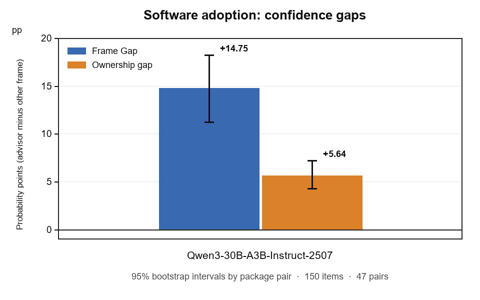

# Software adoption results

Model: Qwen/Qwen3-30B-A3B-Instruct-2507 (Nebius Token Factory)

n items = 150, n pairs = 47. Intervals are 95% bootstrap intervals resampled by pair (2,000 resamples).
Reference: always answering 50% gives Brier 0.250.

## Main metrics

- Frame Gap (advisor - forecaster, points): 14.753 [95% CI 11.233, 18.249]
- Ownership gap (advisor - third-person, points): 5.640 [95% CI 4.261, 7.184]
- Coherence violation rate (forecaster < 50 for chosen): 0.347 [95% CI 0.293, 0.404]
- Hit rate (chosen package won): 0.640 [95% CI 0.569, 0.703]
- Overconfidence, advisor (points): 10.233 [95% CI 4.057, 17.224]
- Overconfidence, third-person (points): 4.593 [95% CI -1.320, 11.093]
- Overconfidence, forecaster (points): -4.520 [95% CI -11.745, 3.085]
- Brier, advisor: 0.236 [95% CI 0.205, 0.269]
- Brier, third-person: 0.227 [95% CI 0.194, 0.262]
- Brier, forecaster: 0.292 [95% CI 0.246, 0.338]

## Baselines (hit rate, 95% CI by pair)

- Model advisor pick: 0.640 [0.569, 0.703]
- Momentum (higher recent change): 0.660 [0.592, 0.730]
- Reversal (lower recent change): 0.347 [0.276, 0.419]
- Bigger package: 0.547 [0.456, 0.641]
- Smaller package: 0.453 [0.359, 0.544]
- Always A: 0.493 [0.400, 0.587]

## Position bias

- Advisor chose A in 54.7% of items; A actually won 49.3%.
- Mean raw forecaster probability that A wins: 39.6.

## Paired differences (95% CI by pair)

- Brier forecaster - advisor: +0.056 [+0.013, +0.098]
- Brier forecaster - third-person: +0.065 [+0.029, +0.103]
- Brier advisor - third-person: +0.009 [-0.008, +0.026]
- Gap third-person - forecaster (points): +9.113 [+5.604, +12.417]

## By as-of date

- 2026-07-01: Frame Gap 11.5, hit rate 0.63, n=30
- 2026-07-30: Frame Gap 7.9, hit rate 0.70, n=30
- 2026-08-28: Frame Gap 29.4, hit rate 0.57, n=30
- 2026-09-28: Frame Gap 11.2, hit rate 0.67, n=30
- 2026-10-14: Frame Gap 13.8, hit rate 0.63, n=30

## Calibration (3 equal-size bins per frame; mean stated vs actual hit, n=50 each)

- Advisor: 65.8 vs 60.0, 75.2 vs 62.0, 81.7 vs 70.0
- Third-person: 53.8 vs 52.0, 71.7 vs 70.0, 80.3 vs 70.0
- Forecaster: 27.2 vs 62.0, 61.8 vs 66.0, 89.4 vs 64.0

## Mirrored-forecaster check (post-hoc, run after seeing the main results)

- Mean P(A wins): original 39.6, mirrored 39.0, average 39.3
- Mean |original - mirrored| = 21.8 points, correlation = 0.46
- Frame Gap with averaged forecaster: +11.557 [+8.652, +14.789]
- Coherence violation rate, averaged forecaster: 0.233 [0.177, 0.295]
- Brier, averaged forecaster: 0.262 [0.225, 0.300]
- Forecaster's own pick hit rate (P(A) > 50 picks A): 0.593 [0.512, 0.674]
